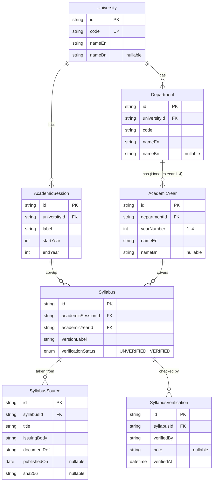

# Entity Relationship Diagram

Module 1 - Academic structure. Every relation is a required foreign key with `ON DELETE RESTRICT`
(academic records are never removed implicitly).

Unique keys: `University.code`; `(universityId, code)` on Department; `(departmentId, yearNumber)` on
AcademicYear; `(universityId, label)` on AcademicSession; `(academicSessionId, academicYearId,
versionLabel)` on Syllabus.
