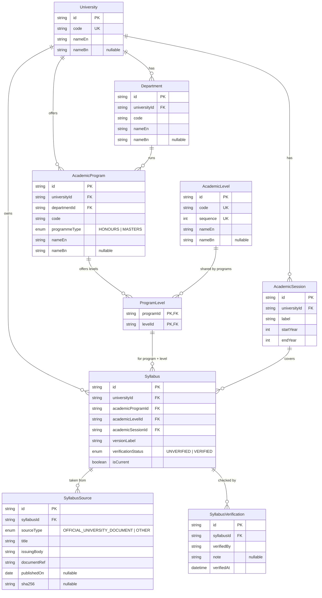

# Entity Relationship Diagram

Module 1 - Academic structure (multi-university). Every relation is a required foreign key with
`ON DELETE RESTRICT` (academic records are never removed implicitly).

`AcademicLevel` is the only table that is **not** per university: five shared rows.

Same-university guarantees (composite foreign keys, all including `universityId`):
`AcademicProgram(departmentId, universityId) -> Department`,
`Syllabus(academicProgramId, universityId) -> AcademicProgram`,
`Syllabus(academicSessionId, universityId) -> AcademicSession`, and
`Syllabus(academicProgramId, academicLevelId) -> ProgramLevel` (the program must offer the level).

Unique keys: `University.code`; `AcademicLevel.code` and `.sequence`; `(universityId, code)` on
Department and AcademicProgram; `(universityId, label)` on AcademicSession; `(programId, levelId)` is
the key of ProgramLevel; `(academicProgramId, academicLevelId, academicSessionId, versionLabel)` on
Syllabus. `(id, universityId)` is unique on Department, AcademicProgram and AcademicSession as the
target of the composite keys.
